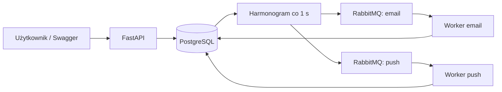

# Laboratorium 2 — symulator powiadomień

Aplikacja pozwala zaplanować powiadomienie e-mail albo push. Wysyłka jest symulowana: jej wynikiem jest wpis w bazie, widoczny przez API. Nie potrzeba konta pocztowego ani telefonu.

## Uruchomienie

Potrzebny jest Docker Desktop z uruchomionym silnikiem kontenerów Linux. Python i baza nie muszą być zainstalowane na komputerze.

W terminalu, z katalogu `lab2`:

```powershell
docker compose up -d --build
docker compose ps
```

Pierwszy start pobiera obrazy i instaluje biblioteki. Migracja tworzy tabele automatycznie. Kontener `migrate` kończy pracę z kodem 0 — to poprawny wynik.

- Panel do prezentacji: **http://localhost:8000/**.
- Dokumentacja API (Swagger): **http://localhost:8000/docs**.
- Kontrola API i połączenia z bazą: **http://localhost:8000/health**.
- Panel RabbitMQ: **http://localhost:15672**, login i hasło: `lab2`.

Zatrzymanie, z zachowaniem danych:

```powershell
docker compose down
```

Ponowne uruchomienie: `docker compose up -d`. Baza i kolejki są w nazwanych wolumenach. Dane pozostają po zatrzymaniu i odtworzeniu kontenerów. Polecenie `docker compose down -v` usuwa również wszystkie dane tego laboratorium — używać tylko przy świadomym resetowaniu projektu.

## Szybki pokaz prowadzącemu

Otwórz **http://localhost:8000/**. Panel nie wymaga instalowania dodatkowych narzędzi.

1. Kliknij **Wypełnij przykład** — termin zostanie ustawiony za 15 sekund, w strefie odbiorcy będzie dzień.
2. Wybierz kanał i liczbę symulowanych błędów, następnie kliknij **Zaplanuj powiadomienie**.
3. Obserwuj zmianę statusu na liście; odświeża się automatycznie co 3 sekundy.
4. Kliknij **Historia prób**, aby pokazać kolejne próby i ich wyniki.
5. Zaplanuj kolejne powiadomienie na później i pokaż **Wyślij teraz** albo **Anuluj**.

Obok listy działa **Skrzynka odbiorcza**: niezależny podgląd ostatnich 20 zapisów dostarczenia z `/deliveries`, odświeżany co 3 sekundy. Można filtrować po dokładnym identyfikatorze odbiorcy i kanale. Są tam treść, odbiorca, kanał, czas odbioru i identyfikator wiadomości. Zlecenia oczekujące, anulowane i zakończone błędem nie trafiają do skrzynki. To podgląd symulowanego odbioru zapisanego przez worker, nie prawdziwa poczta ani telefon.

Do pokazania różnicy zatrzymaj `docker compose stop email-worker`, zaplanuj e-mail przez „Wypełnij przykład” i poczekaj na termin: pozostanie w kolejce, bez nowej wiadomości w skrzynce. Po `docker compose start email-worker` pojawi się dostarczenie. Push może w tym czasie działać niezależnie.

Termin w formularzu wpisuje się w czasie przeglądarki, wskazanym pod polem daty. Na liście terminy są pokazywane w strefie odbiorcy. Podsumowanie dotyczy bieżącej strony (maksymalnie 50 pozycji); dostępne są filtr statusu i przechodzenie między stronami. „Wyślij teraz” nadal respektuje ciszę nocną.

Alternatywnie możesz uruchomić automatyczny pokaz:

Po uruchomieniu:

```powershell
docker compose exec api python scripts/demo.py
```

Skrypt tworzy prawdziwe zlecenia przez API. Sprawdza e-mail, push, sukces po dwóch błędach, zakończenie po trzech błędach, anulowanie, wysłanie teraz i brak duplikatów. Trwa zwykle kilkanaście sekund. Każde uruchomienie dopisuje własne dane pokazowe.

Skrypt dobiera strefę odbiorcy, w której jest południe, żeby pokaz zadziałał także wieczorem w Polsce. Normalna domyślna strefa API to `Europe/Warsaw`; obowiązuje cisza nocna.

Następnie otwórz `/docs` i pokaż:

1. `GET /notifications` — terminy, priorytety, statusy i liczbę prób.
2. `GET /notifications/{notification_id}/attempts` — historię prób wskazanego powiadomienia.
3. `GET /deliveries` — pojedyncze wpisy symulowanych dostarczeń.
4. Panel RabbitMQ — osobne kolejki `email` i `push`.

Logi procesów wysyłających i harmonogramu:

```powershell
docker compose logs --tail 50 email-worker push-worker scheduler
```

## Ręczne utworzenie powiadomienia

W `/docs` wybierz `POST /notifications`, następnie **Try it out**. Przykładowe dane:

```json
{
  "recipient": "student@example.com",
  "content": "Przypomnienie o laboratorium",
  "channel": "email",
  "timezone": "Europe/Warsaw",
  "priority": "high",
  "scheduled_at": "2030-11-04T12:00:00+01:00",
  "simulate_failures": 0
}
```

Podmień termin na przyszłą datę. Data musi zawierać offset, np. `+01:00`, `+02:00` albo `Z` dla UTC. Offset jednoznacznie określa chwilę, a `timezone` określa lokalną ciszę nocną odbiorcy. Podczas powtórzenia godziny jesienią offset rozróżnia dwa możliwe terminy; nie przyjmujemy lokalnych dat bez offsetu.

`channel`: `email` lub `push`. `priority`: `low` lub `high`. `simulate_failures` określa liczbę pierwszych prób zakończonych błędem: `0` oznacza natychmiastowy sukces, `2` sukces przy trzeciej próbie, `3` błąd końcowy. Odbiorca jest identyfikatorem symulowanego użytkownika, nie musi być prawdziwym adresem pocztowym.

API zwraca `id`. Użyj go w:

| Operacja | Endpoint |
|---|---|
| Lista, opcjonalnie filtr statusu | `GET /notifications?status=pending` |
| Szczegóły | `GET /notifications/{id}` |
| Anulowanie | `POST /notifications/{id}/cancel` |
| Najbliższy dozwolony termin | `POST /notifications/{id}/send-now` |
| Historia prób | `GET /notifications/{id}/attempts` |
| Dostarczone wiadomości | `GET /deliveries` |

Listy mają parametry `limit` (domyślnie 100, maksymalnie 500) i `offset`.
Lista dostarczeń ma również filtr `notification_id`, np. `/deliveries?notification_id=IDENTYFIKATOR`.

## Zgodność z PDF

Wymagania znajdują się na stronach 1–2 materiału. Strony 3–8 zawierają propozycje technologii i przykłady kodu; projekt korzysta z wariantu Python.

| Wymaganie | Miejsce realizacji |
|---|---|
| Treść, odbiorca, kanał i strefa | `schemas.py`, `models.py`, formularz panelu |
| Planowanie konkretnego terminu | `service.py`, `scheduler.py` |
| Niezależne instancje kanałów | `compose.yaml`: `email-worker` i `push-worker`, osobne kolejki |
| Trwałe przechowywanie i praca asynchroniczna | PostgreSQL, trwały RabbitMQ, harmonogram, Celery |
| Brak podwójnego efektu dostarczenia | Transakcja i blokada w `service.py`, unikalny zapis `Delivery` |
| Trzy próby przy problemach | `service.py`: licznik, historia i kolejny termin w bazie |
| Preferowanie wysokiego priorytetu | Kolejność harmonogramu i priorytety RabbitMQ |
| Anulowanie i wymuszenie wysyłki | Endpointy `cancel` / `send-now`, przyciski panelu, wersjonowanie zadań |
| Lokalne strefy i cisza nocna | `time_rules.py`, ponowna kontrola godziny w workerze |

Wymóg „dokładnie raz” dotyczy efektu symulowanego dostarczenia; trwały błąd po trzech próbach jest raportowany jako `failed`. „Wyślij teraz” respektuje ciszę nocną, a harmonogram działa z dokładnością obiegu i dostępności kolejki. Szczegółowe zasady i granice gwarancji opisano poniżej.

## Przyjęte zasady

- Trzy próby **łącznie**, z odstępem co najmniej 5 sekund po błędzie. Noc może wydłużyć ten odstęp.
- Cisza nocna: **22:00–07:00 w strefie odbiorcy**. Nocny termin przesuwa się na 07:00. Wysyłka sprawdza ciszę ponownie po odebraniu zadania.
- „Wyślij teraz” także respektuje ciszę nocną. W dzień ustawia bieżącą chwilę; wykonanie nastąpi w najbliższym obiegu harmonogramu i po zwolnieniu workera.
- Anulowanie i zmiana terminu dotyczą stanów `pending` i `queued`. Po dostarczeniu lub ostatecznym błędzie zwracany jest HTTP 409.
- Jeśli worker i anulowanie działają jednocześnie, wygrywa operacja, która pierwsza zablokuje wiersz w PostgreSQL. Gdy dostarczenie zostało zatwierdzone, anulowanie zwróci 409.
- Terminy zapisujemy w UTC. Reguły lokalnych godzin korzystają ze stref IANA, uwzględniając zmianę czasu.
- Wysoki priorytet jest preferowany w harmonogramie i kolejce RabbitMQ. Nie przerywa już wykonywanej wysyłki i nie przyspiesza wiadomości przed jej terminem. Nie gwarantujemy globalnego porządku między niezależnymi kanałami. Przy nieprzerwanym napływie wysokiego priorytetu niski może czekać dłużej.
- Po trzecim błędzie status to `failed`. Powiadomienie i historia zostają w bazie; system nie udaje udanego dostarczenia przy trwałej awarii.

Godziny ciszy można zmienić zmiennymi `QUIET_START` i `QUIET_END` przed `docker compose up -d`. Równe wartości wyłączają ciszę. Domyślnie nie trzeba nic konfigurować.

## Jak działa rozwiązanie



Każdy element aplikacji działa w osobnym kontenerze. Zatrzymanie workera e-mail nie zatrzymuje push ani przyjmowania nowych powiadomień.

1. API zapisuje powiadomienie w PostgreSQL w stanie `pending`.
2. Harmonogram wybiera gotowe powiadomienia, najpierw z wysokim priorytetem. Przekazuje do trwałej kolejki identyfikator i wersję, następnie zapisuje `queued`.
3. Worker blokuje wiersz powiadomienia. Sprawdza wersję, status, termin i ciszę nocną.
4. Worker zapisuje próbę. Sukces to wpis w `deliveries` i stan `sent`, zatwierdzone razem. Błąd ustawia nowy termin w bazie albo stan `failed` po trzeciej próbie.

Przejścia stanów:

```text
pending -> queued -> sent
                  -> pending (ponowienie lub cisza nocna)
                  -> failed  (trzeci błąd)
pending / queued  -> cancelled
pending / queued  -> pending (wyślij teraz, nowa wersja)
```

Ponowienia są wykonywane przez workery Celery, a termin i licznik prób przechowuje PostgreSQL. Używamy jednego mechanizmu planowania, zamiast dodatkowo wywoływać `Celery.retry` — dzięki temu restart nie gubi terminu ani limitu prób.

## Niezawodność i „dokładnie raz”

Wiersz powiadomienia jest jednocześnie trwałym zleceniem do opublikowania. Jeśli RabbitMQ jest niedostępny, transakcja harmonogramu zostaje wycofana i zlecenie nadal czeka w bazie. Używamy trwałych kolejek, trwałych komunikatów i potwierdzeń publikacji. Jeśli wynik nie pojawi się przez 30 sekund, harmonogram może opublikować zadanie ponownie. Przy długo zatrzymanym workerze mogą więc występować duplikaty zadań w kolejce.

**Efekt symulowanego dostarczenia występuje raz**: blokada wiersza, sprawdzanie stanu i unikalny identyfikator dostarczenia chronią przed ponownym zapisem. Zapis dostarczenia, próby i statusu jest jedną transakcją. Awaria przed jej zatwierdzeniem cofa całość. Awaria po zatwierdzeniu, ale przed potwierdzeniem RabbitMQ, powoduje ponowne odebranie zadania, które zostanie pominięte. Anulowanie i „wyślij teraz” zwiększają wersję, więc stare zadania nie wyślą wiadomości.

Ta gwarancja dotyczy **symulacji w bazie**. Przy podłączeniu prawdziwego zewnętrznego dostawcy e-mail/push potrzebne byłoby jego wsparcie dla idempotencji. Przy trzech trwałych błędach nie można zagwarantować sukcesu dostarczenia; pokazujemy wtedy jawnie `failed` i zachowujemy dane. Rozwiązanie zakłada sprawną trwałą bazę oraz możliwość ponownego uruchomienia usług, a nie utratę wolumenów.

## Testy

Testy logiki i API z SQLite, bez blokad PostgreSQL:

```powershell
docker compose exec -e DATABASE_URL=sqlite:// api python -m pytest -q
```

Testy na PostgreSQL, w tym równoległe przetwarzanie i wyścigi anulowania:

```powershell
docker compose exec -e TEST_DATABASE_URL=postgresql+psycopg://lab2:lab2@db:5432/lab2 api python -m pytest -q
```

Każdy test używa osobnego schematu; dane aplikacji nie są kasowane. Testy obejmują walidację, oba kanały, limity prób, duplikaty, awarie transakcji/publikacji, odzyskiwanie zadań, priorytety, stare wersje oraz strefy i zmianę czasu.

Pełny test z prawdziwym brokerem, zatrzymaniem kolejno obu kanałów i restartem bazy oraz RabbitMQ (PowerShell, z `lab2`):

```powershell
powershell -ExecutionPolicy Bypass -File scripts/test-system.ps1
```

Test dopisuje dane pokazowe, na chwilę zatrzymuje kolejno worker e-mail i push oraz restartuje usługi tego projektu. Przywraca zatrzymane workery. Nie uruchamiaj równocześnie drugiej kopii scenariusza.

Sprawdzono 31.10.2026: **31 testów na PostgreSQL przeszło**, w tym obsługa 250 oczekujących zleceń. Pełny scenariusz systemowy także przeszedł: oba kanały pracują niezależnie, a po restarcie bazy i brokera oczekujące wiadomości zostały dostarczone bez duplikatów. Testy regresji obejmują godzinę po uzyskaniu blokady, niedostępną bazę i filtrowanie dostarczeń. `alembic check` potwierdził zgodność modeli z migracją. Boczna skrzynka została dodatkowo sprawdzona w Chromium z zatrzymaniem i ponownym uruchomieniem workera e-mail oraz działającym równolegle push.

## Pliki do omówienia na oddaniu

| Plik | Za co odpowiada |
|---|---|
| `app/main.py` | Endpointy API |
| `app/static/` | Panel: HTML, CSS i JavaScript, bez dodatkowych bibliotek |
| `app/schemas.py` | Walidacja danych wejściowych i format odpowiedzi |
| `app/models.py` | Trzy tabele: powiadomienia, próby, dostarczenia |
| `app/service.py` | Tworzenie, anulowanie, wysyłanie i ponowienia |
| `app/time_rules.py` | UTC, strefy i cisza nocna |
| `app/scheduler.py` | Wybór gotowych zleceń i publikacja do kolejek |
| `app/tasks.py` | Konfiguracja Celery i zadanie wysyłki |
| `migrations/` | Migracja Alembic tworząca bazę |
| `compose.yaml` | Osobne instancje i trwałe wolumeny |
| `tests/` | Automatyczna weryfikacja |

Do oddania wystarcza folder `lab2` z kodem, wymaganiami i tym README. Nie dołączaj `.venv`, cache ani danych kontenerów. PDF i `TODO.md` służą jako materiał i lista realizacji.

Dokumentacja wykorzystanych mechanizmów: [transakcje SQLAlchemy](https://docs.sqlalchemy.org/en/20/orm/session_basics.html), [potwierdzenia i prefetch Celery](https://docs.celeryq.dev/en/stable/userguide/optimizing.html), [priorytety RabbitMQ](https://www.rabbitmq.com/docs/priority).
